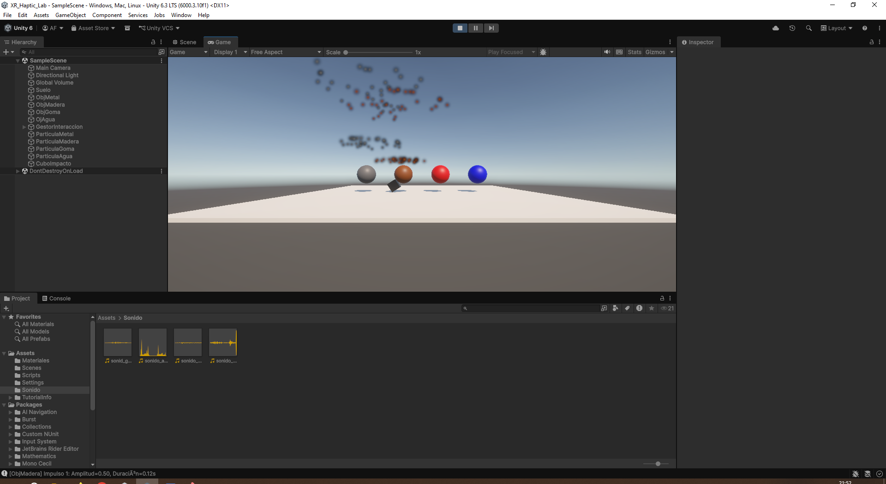

# XR Haptic Lab

Laboratorio de realidad extendida (XR) y retroalimentación háptica, desarrollado en Unity 6.3 con el Universal Render Pipeline (URP).

El proyecto simula la percepción de materiales mediante realimentación háptica visual, sonora y de partículas. Cada objeto de la escena responde a un impacto con un patrón de vibración, un cambio de color, un sonido y un efecto de partículas propio según el material, con el fin de estudiar cómo el usuario percibe las propiedades de una superficie (metal, madera, goma y agua) a partir de estímulos multimodales sincronizados.



*Figura 1.* El cubo de impacto (`CuboImpacto`) cae sobre los objetos de la escena y dispara la respuesta háptica correspondiente. En la imagen se observan las partículas de los objetos de metal y madera durante el impacto.

---

## Requisitos

| Elemento | Versión |
| :--- | :--- |
| Motor | Unity 6000.3.10f1 (Unity 6.3) |
| Render pipeline | Universal Render Pipeline 17.3.0 |
| Sistema de entrada | Input System 1.18.0 |
| Lenguaje | C# |
| Escena principal | `Assets/Scenes/SampleScene.unity` |

---

## Estructura del proyecto

```
XR_Haptic_Lab/
├── Assets/
│   ├── Scenes/SampleScene.unity     # Escena principal del laboratorio
│   ├── Scripts/                      # Lógica háptica (3 scripts)
│   ├── Materiales/                   # Mat_Metal, Mat_Madera, Mat_Goma, Mat_Agua, Mat_Cubo, Mat_Suelo
│   ├── Sonido/                       # Un sample de audio por material
│   ├── Settings/                     # Assets de URP (PC y Mobile)
│   └── InputSystem_Actions.inputactions
├── Packages/manifest.json
├── ProjectSettings/
├── docs/Image.PNG
└── README.md
```

---

## Scripts

### `SimuladorHaptico.cs`

Componente central del proyecto. Se añade a cada objeto interactivo y expone los parámetros del estímulo en el Inspector.

| Parámetro | Rango | Descripción |
| :--- | :--- | :--- |
| `amplitud` | 0 – 1 | Intensidad del impulso. Controla cuánto se acerca el color a blanco. |
| `duracion` | ≥ 0.01 s | Duración de cada pulso individual. |
| `pulsosPorSegundo` | ≥ 1 | Frecuencia del patrón de vibración. |
| `cantidadPulsos` | ≥ 1 | Número de pulsos que componen el estímulo. |
| `particulas` | ParticleSystem | Sistema de partículas que se dispara al activarse. |
| `audioImpacto` | AudioSource | Fuente de audio asociada al material. |

Al activarse, el componente detiene la corrutina anterior, dispara las partículas, reproduce el audio e inicia una corrutina que, por cada pulso, interpola el color del renderer hacia blanco, espera el tiempo configurado y restaura el color original. Cuando hay más de un pulso, la intensidad de cada uno se multiplica por un factor aleatorio entre 0.7 y 1.0 para que la sensación resulte más orgánica.

### `DetectorColisionHaptica.cs`

Se ejecuta en `OnCollisionEnter` y decide si el impacto merece respuesta. Descarta colisiones por debajo de `velocidadMinima` (0.5) y las que ocurren dentro del intervalo `intervaloMinimo` (0.3 s) desde el último estímulo. Si supera ambos filtros, invoca `SimuladorHaptico.ActivarFeedback()`.

### `ControladorInteraccion.cs`

Permite activar el estímulo bajo demanda, sin colisión física. Detecta el clic izquierdo, lanza un raycast desde la cámara (`distanciaMaxima`, por defecto 100) y activa el `SimuladorHaptico` del objeto alcanzado, si lo tiene.

---

## Objetos de la escena

Todos los objetos hápticos comparten la misma estructura: `MeshFilter`, `MeshRenderer`, `Rigidbody`, `Collider`, `AudioSource`, `SimuladorHaptico` y `DetectorColisionHaptica`.

| Objeto | Material | Sonido | Partículas | `amplitud` | `duracion` | `pulsosPorSegundo` | `cantidadPulsos` |
| :--- | :--- | :--- | :--- | :---: | :---: | :---: | :---: |
| `ObjMetal` | `Mat_Metal` | `sonido_metal.mp3` | `ParticulaMetal` | 0.90 | 0.50 s | 10 | 1 |
| `ObjMadera` | `Mat_Madera` | `sonido_madera.mp3` | `ParticulaMadera` | 0.50 | 0.12 s | 5 | 1 |
| `ObjGoma` | `Mat_Goma` | `sonid_goma.mp3` | `ParticulaGoma` | 0.25 | 0.15 s | 4 | 3 |
| `OjAgua` | `Mat_Agua` | `sonido_agua.mp3` | `ParticulaAgua` | 0.15 | 0.10 s | 8 | 8 |

El material `Mat_Cubo` se usa en `CuboImpacto` y `Mat_Suelo` en el plano `Suelo`. El objeto `OjAgua` conserva ese nombre en la jerarquía.

Los valores están calibrados para que cada material se perciba distinto: el metal genera un único pulso largo e intenso (impacto seco), la madera un pulso corto y medio (golpe amortiguado), la goma tres pulsos suaves y espaciados (rebote elástico) y el agua ocho pulsos muy cortos y rápidos (vibración fina).

---

## Ejecución

1. Abrir la carpeta del proyecto con Unity Hub usando la versión 6000.3.10f1.
2. Esperar la importación de paquetes y la compilación de shaders.
3. Abrir `Assets/Scenes/SampleScene.unity` y pulsar **Play**.

El cubo de impacto (`CuboImpacto`) puede arrastrarse para generar impactos sucesivos sobre los objetos. También es posible activar el estímulo con un clic sobre el objeto.

---

## Notas

- **Entrada:** el proyecto incluye el paquete Input System, pero `ControladorInteraccion` utiliza la API clásica `Input.GetMouseButtonDown`. Si en `Project Settings → Player → Active Input Handling` está configurado como *Input System Package (New)*, el clic puede no responder. La solución es añadir un evento `Mouse → Left Button` en las Actions del proyecto o cambiar la llamada a `Mouse.current.leftButton.wasPressedThisFrame`.
- **Depuración:** el proyecto registra los eventos en la consola, por ejemplo `[ObjMetal] Impulso 1: Amplitud=0.90, Duracion=0.50s`, lo que permite verificar el comportamiento de los filtros de velocidad e intervalo.
- **Añadir un material nuevo:** crear el material y el sample de audio, asignar un sistema de partículas y ajustar los cuatro parámetros del patrón en el Inspector.
